# Transformation of SVGs to assets included in the package

# Brief

This package provides css and icon assets for displaying monochrome icons.

The [`AdjustCssBundle.targets`](Targets/AdjustCssBundle.targets) file extends the build process for scoped CSS bundling.

It hooks into the scoped CSS bundling step and runs after `BundleScopedCssFiles`. It automatically prepends an `@import url('./styles.css');` to the generated bundle file.

This ensures that the package’s styles are automatically included in the CSS bundle provided by the package, which itself is imported in the final CSS bundle of the consuming project, without requiring the consumer to add the import manually.

# Implementation

## Folders

Folder | Description
-|-
`Sketch.Incoming` | Receives extracted [contents](https://git.nsc-gmbh.de/vo-ui/vo-monochrome-icons/-/issues/13#note_146109) from a `.zip` export
`Sketch.Original` | Copy of `Sketch.Incoming` to have the original state commited
`Sketch.Sanitized` | Files sanitized by task `SanitizeSvgs`, verified as SVGO-idempotent by target `VerifySanitizedSvgs`
`Temp` | Temporary copy of `Sketch.Incoming` for sanitizing files
`wwwroot` | Transformed files from `Sketch.Sanitized`

> The `Temp` directory allows multiple consecutive execution of a build without the need to extracted contents from a .zip export before each build when target `CleanIncomingDirectory` is disabled. Also it avoids that, without a temp folder, sanitized files in `Sketch.Incoming` would be copied to `Sketch.Original` in a consecutive build.

## MSBuild target execution order when building the project

```mermaid
flowchart LR
    CopySketchIncomingToSketchOriginal
    CreateTempDirectory
    CopySketchIncomingToTempDirectory
    SanitizeSvgs
    CopySanitizedFilesToSanitizedDirectory
    SyncronizeSketchSanitizedWithSketchOriginal
    CopySanitizedSvgsForVerification
    VerifySanitizedSvgs
    CleanWwwRootDirectory
    ImportSketch
    CreateMonochromeIconItemsFromWwwRoot
    CreateMonochromeIconVariantItems
    AfterCopyMonochromeIconScss
    AfterMonochromeIconTargets
    IncludeGeneratedStaticWebAsset
    RemoveTempDirectory
    CleanIncomingDirectory
    PreBuildEvent

    CreateTempDirectory-->CopySketchIncomingToTempDirectory
    CopySketchIncomingToTempDirectory-->SanitizeSvgs
    SanitizeSvgs-->CopySanitizedFilesToSanitizedDirectory

    CopySanitizedFilesToSanitizedDirectory-->CleanWwwRootDirectory
    CopySanitizedFilesToSanitizedDirectory-. "depends on" .->SyncronizeSketchSanitizedWithSketchOriginal
    CopySanitizedFilesToSanitizedDirectory-. "depends on" .->CopySanitizedSvgsForVerification
    CopySanitizedSvgsForVerification-->VerifySanitizedSvgs

    CopySketchIncomingToSketchOriginal-->SyncronizeSketchSanitizedWithSketchOriginal

    SyncronizeSketchSanitizedWithSketchOriginal-->ImportSketch
    VerifySanitizedSvgs-->ImportSketch
    CleanWwwRootDirectory-->ImportSketch

    ImportSketch-->CreateMonochromeIconItemsFromWwwRoot
    CreateMonochromeIconItemsFromWwwRoot-->CreateMonochromeIconVariantItems
    CreateMonochromeIconVariantItems-->AfterCopyMonochromeIconScss
    AfterCopyMonochromeIconScss-->AfterMonochromeIconTargets
    AfterMonochromeIconTargets-->PreBuildEvent

    ImportSketch-->IncludeGeneratedStaticWebAsset
    ImportSketch-->RemoveTempDirectory

    RemoveTempDirectory-->CleanIncomingDirectory
    CleanIncomingDirectory-->PreBuildEvent
```

## MSBuild properties

| MSBuild property | Description | Default value |
|-|-|-|
| `ShouldVerifySanitizedSvgs` | Determines whether to perform the SVGO idempotency check on sanitized SVGs. | `true` |

