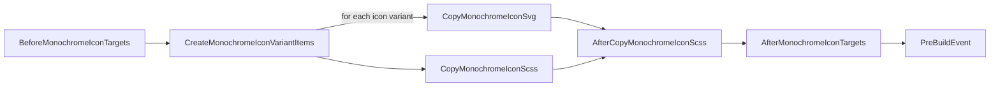

# Transformation of SVGs to assets included in the package

# Brief

This package provides assets for displaying monochrome icons. These assets referenced via MSBuild items are copied via MSBuild targets to locations specified by MSBuild properties. The resulting files can then be included in your asset pipeline.

| MSBuild target | Description |
|-|-|
| `BeforeMonochromeIconTargets` | Provided as entry point to define MSBuild items override MSBuild property defaults |
| `AfterMonochromeIconTargets` | Provided as entry point for third-party targets executed after monochrome icon targets |

| MSBuild item | Description | Example |
|-|-|-|
| `MonochromeIcon` | Requests a set of assets for an icon specified via `Include` attributes | `<MonochromeIcon Include="refresh"> ... </MonochromeIcon>` |

| MSBuild item metadata | Description | Example |
|-|-|-|
| `Size` | Defines required sizes for an icon | `<MonochromeIcon Size="16;32"> ... </MonochromeIcon>`

| MSBuild property | Description | Default value |
|-|-|-|
| `MonochromeIconSvgOutputFolder` | Location for `.svg` files in your project | `$(MSBuildProjectDirectory)/wwwroot/monochrome-icons` |
| `MonochromeIconScssOutputFolder` | Location for `.scss` files in your project | `$(MSBuildProjectDirectory)/Styles/monochrome-icons` |

# Example configuration

  ``` xml
  <Target Name="ConfigureMonochromeIcons" BeforeTargets="BeforeMonochromeIconTargets">
    <!-- Specify required icons by icon name in dash-case and size -->
    <ItemGroup>
      <MonochromeIcon Include="refresh" Size="16;32" />
      <MonochromeIcon Include="switch-off" Size="32" />
      ...
    </ItemGroup>

    <!-- Specify target locations -->
    <PropertyGroup>
      <MonochromeIconSvgOutputFolder>$(MSBuildProjectDirectory)/wwwroot/icons/monochrome-icons</MonochromeIconSvgOutputFolder>
      <MonochromeIconScssOutputFolder>$(MSBuildProjectDirectory)/Styles/icons/monochrome-icons</MonochromeIconScssOutputFolder>
    </PropertyGroup>
  </Target>
  ```

# Implementation

## Folders

Folder | Description
-|-
`Sketch.Incoming` | Receives extracted [contents](https://git.nsc-gmbh.de/vo-ui/vo-monochrome-icons/-/issues/13#note_146109) from a `.zip` export
`Sketch.Original` | Copy of `Sketch.Incoming` to have the original state commited
`Sketch.Sanitized` | Files sanitized by task `SanitizeSvgs`
`Temp` | Temporary copy of `Sketch.Incoming` for sanitizing files
`wwwroot` | Transformed files from `Sketch.Sanitized`

> The `Temp` directory allows multiple consecutive execution of a build without the need to extracted contents from a .zip export before each build when target `CleanIncomingDirectory` is disabled. Also it avoids that, without a temp folder, sanitized files in `Sketch.Incoming` would be copied to `Sketch.Original` in a consecutive build.

## MSBuild target execution order when building the project

```mermaid
flowchart LR
    CopySketchIncomingToSketchOriginal
    CreateTempDirectory
    CopySketchIncomingToTempDirectory
    CleanIncomingDirectory
    SanitizeSvgs
    CopySanitizeFilesToSanitizeDirectory
    SyncronizeSketchSanitizedWithSketchOriginal
    RemoveTempDirectory
    CleanWwwRootDirectory
    ImportSketch
    IncludeGeneratedStaticWebAsset
    PreBuildEvent

    CreateTempDirectory-->CopySketchIncomingToTempDirectory
    CopySketchIncomingToTempDirectory-->SanitizeSvgs
    SanitizeSvgs-->CopySanitizeFilesToSanitizeDirectory
    CopySanitizeFilesToSanitizeDirectory-->CleanWwwRootDirectory
    CleanWwwRootDirectory-->ImportSketch
    ImportSketch-->IncludeGeneratedStaticWebAsset
    IncludeGeneratedStaticWebAsset-->RemoveTempDirectory

    RemoveTempDirectory-->CleanIncomingDirectory
    CleanIncomingDirectory-->PreBuildEvent

    CopySanitizeFilesToSanitizeDirectory-. "required for" .->SyncronizeSketchSanitizedWithSketchOriginal
    SyncronizeSketchSanitizedWithSketchOriginal-->ImportSketch

    CopySketchIncomingToSketchOriginal-->SyncronizeSketchSanitizedWithSketchOriginal
```



## MSBuild target execution order when building a project that has a `PackageReference` to this project


